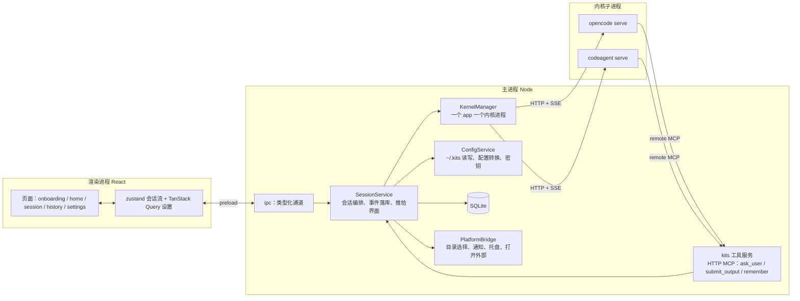

# kits 第一阶段实现方案：通用 Agent 的分 PR 实施

> 版本：v1.0（草案）　日期：2026-11-03　状态：评审中
>
> 本文把 [phase1.md](phase1.md)（做什么、为什么）和 [designs/app](../../designs/app/index.html)（长什么样）落成可以逐个 PR 执行的实现方案：架构怎么分层、数据怎么存、配置怎么转、界面怎么拆、测试怎么跑、PR 按什么顺序做。后续每个 PR 的交付说明引用本文的对应小节，不再重复写背景。
>
> 范围结论（2026-11-03 和负责人确认）：
> - 内核以 **OpenCode 为主**走通全流程；CodeAgent 二进制暂时拿不到、只有 Windows 版，方言层按 [codeagent-sdk.md](../references/codeagent-sdk.md) 编写、用假服务测试，真机验证由负责人在 Windows 上做。
> - 进范围：记忆（项目 / 个人）、上下文压缩、深色主题（界面只做中文，文案集中到一张表，以后加语言不改页面）、系统通知和关窗后台运行、附件转文本（Word / PDF）、打包和内网自动更新（证书和更新地址还没有，先出未签名包，更新地址做成配置项）。
> - 标为**后续**、本方案不排 PR：结构化产出的逐条审核（保留 / 修改 / 删除、采纳统计）和 Excel 导出、“结果靠谱吗”点赞点踩反馈、`@` 引用需求平台（依赖 MCP 服务是否存在）、推送到缺陷平台。结构化产出本阶段只做 JSON 视图和 JSON 导出。

## 1. 目标和验收标准

做完本方案的全部 PR 后，一个测试同学从安装包装上 kits，十分钟内能走完下面这条链，并且每一步都有原型里对应的状态：

1. 首次引导：配一个模型网关（测试连接、拉模型列表、选默认模型），选一个工作目录，粘贴 MCP 配置或跳过。
2. 首页输入任务，`/` 选技能，`@` 引用工作目录里的文件，拖一个 Word 或 PDF 进来。
3. 会话页实时看到正文、思考过程和工作步骤；执行命令前弹确认卡片，可以允许一次、本会话允许或拒绝并说明原因；Agent 用 `ask_user` 提问时出现提问卡片，不阻塞时它先按假设继续。
4. 右侧面板看改动的 diff（统一 / 并排，可放大）、命令输出、上下文用量；上下文接近上限时提示并可手动压缩。
5. 完成后看总结卡片，编辑回复正文后导出 Markdown；结构化产出导出 JSON。
6. 网关断连自动重试并显示“重试中”；内核进程退出显示出错卡片，可以继续这一轮。
7. 设置里改网关、内核、MCP（每个工具三档权限）、技能（内置 / 项目 / 个人三级）、记忆、Agent（Markdown 文件）、通用（主题、字号、通知、启动行为）。
8. 关窗后会话继续跑，需要处理时发系统通知；⌘K 搜会话；会话历史按状态筛选。
9. 换成 OpenCode 内核不用改任何配置（CodeAgent 真机验证通过后反过来也成立）。

## 2. 架构

### 2.1 进程和模块



- `packages/core`：统一配置模型（zod）、`KernelEvent`、权限解析、kits 工具定义、IPC 契约类型。不依赖 Electron。
- `packages/kernel`：`AgentKernel` 实现（OpenCode 系适配器）、方言层、配置转换（统一配置 → 内核配置文件）、SSE 事件映射、Mock 内核。不依赖 Electron。
- `apps/desktop/src/main`：`KernelManager`、`SessionService`、`ConfigService`、kits 工具服务的宿主、数据库、`PlatformBridge`。
- `apps/desktop/src/renderer`：页面和组件。只通过 `window.kits` 和主进程说话，不碰文件系统。

### 2.2 目录规划

```
packages/core/src/
  config/            agent.ts mcp.ts permission.ts settings.ts gateway.ts skill.ts memory.ts
  events.ts          KernelEvent
  ipc.ts             IPC 通道名和入参 / 返回值类型（主进程和渲染进程共用）
  tools/             ask-user.ts submit-output.ts remember.ts server.ts http-transport.ts
packages/kernel/src/
  kernel.ts          AgentKernel / KernelDialect 接口
  binary.ts
  adapter/           opencode-family.ts（公共适配器）sse.ts events.ts（映射）status.ts（完成判定）
  dialects/          opencode.ts codeagent.ts
  generate/          opencode-config.ts（统一配置 → opencode.json + skills/ + commands）
  mock/              mock-kernel.ts scenarios/*.json（给 E2E 和界面开发）
  testing/           mock-model.ts（OpenAI 兼容假网关，契约测试用）fake-codeagent.ts
apps/desktop/src/
  main/
    index.ts platform.ts
    config/          config-service.ts（~/.kits 读写）secrets.ts（safeStorage）paths.ts
    kernel/          kernel-manager.ts
    sessions/        session-service.ts thread.ts（事件 → parts 落库）attachments.ts export.ts
    tools/           kits-tool-host.ts（起 HTTP MCP、把 ask_user / remember 接到 SessionService）
    db/              index.ts schema.ts fts.ts
    ipc/             register.ts（按 core/ipc.ts 逐个 handle）push.ts
    notify.ts tray.ts updater.ts
  preload/index.ts
  renderer/src/
    app/             router.tsx providers.tsx theme.ts i18n.ts（文案表）
    ui/              按 Radix 封装的基础件：Button Menu Popover Dialog Tabs Switch Segmented Tooltip Kbd
    shell/           Nav Composer Palette（对应原型 shell.js）
    pages/           onboarding/ home/ session/ history/ settings/{general,model,mcp,skills,agent}
    session/         thread/（各类 block）panels/{changes,output,terminal,context} store.ts
    lib/             format.ts markdown.tsx diff.ts shortcuts.ts
```

### 2.3 配置和数据放哪

| 内容 | 位置 | 说明 |
|---|---|---|
| 用户配置 | `~/.kits/`（可用 `KITS_CONFIG_DIR` 覆盖，E2E 用） | `settings.json`、`mcp.json`、`agents/*.md`、`skills/*/SKILL.md`、`memory.md`。原型设置页底部写的就是这个目录。人能直接改，能用 Git 管。 |
| 项目配置 | `<工作目录>/.agents/` | `agents/*.md`、`skills/`、`memory.md`；`AGENTS.md` 在仓库根目录，内核自己会读。 |
| 内置 | 应用 resources 下的 `builtin/` | `agents/assistant.md`、内置技能（`review`、`explain`、`test`）。只读，用户复制一份改。 |
| 密钥 | `{userData}/secrets.json` | 用 Electron `safeStorage` 加密后的键值表：`gateway:<id>`、`mcp:<name>:<header>`。配置文件里只留占位 `${KITS_SECRET}`。 |
| 运行数据 | `{userData}/` | `kits.db`、`attachments/<sessionId>/`、`kernel/<kernelId>/{config,data,logs}/`、`exports/`。 |
| 生成的内核配置 | `{userData}/kernel/opencode/config/` | `opencode.json`、`skills/`（软链接或拷贝）、`agents/`。每次设置变更重新生成。 |

`{userData}` 是 Electron 的用户数据目录（macOS `~/Library/Application Support/kits/`，Windows `%APPDATA%\kits\`），`KITS_USER_DATA_DIR` 可覆盖。

## 3. 配置模型（packages/core）

所有配置只写一份，zod 定义，转换到内核由 `packages/kernel/generate` 做。

### 3.1 settings.json

```jsonc
{
  "version": 1,
  "general": {
    "theme": "system",            // system | light | dark
    "uiScale": "m",               // s | m | l，对应 12 / 13 / 14px 基准
    "codeFontSize": 12,
    "uiFont": "", "codeFont": "", // 空用默认
    "startup": "last",            // last | new
    "sidebar": "expanded",        // expanded | icons
    "notifyOnWait": true, "notifyOnDone": false, "keepRunning": true
  },
  "kernel": "opencode",           // 新会话用的内核：opencode | codeagent
  "gateways": [
    { "id": "corp", "name": "公司网关", "baseUrl": "https://…/v1", "enabled": true,
      "models": [{ "id": "deepseek-v4-pro", "note": "主力", "contextWindow": 128000, "toolCall": true }] }
  ],
  "defaultModel": "corp/deepseek-v4-pro",   // <网关 id>/<模型 id>
  "permissionMode": "ask",                  // ask | read | auto（输入框上的三档）
  "workdirs": [{ "path": "/Users/me/repo/member-svc", "lastUsedAt": 0 }],
  "onboardingDone": false
}
```

- 网关的 API Key 不在这里，在 secrets。`gateway.test` 发 `GET {baseUrl}/models` 拿列表并量延迟；模型的 `contextWindow` 网关接口不给，默认 128K，设置页可改（上下文用量条要用）。
- 模型 id 统一写成 `<网关 id>/<模型 id>`，内核配置里网关 id 就是 provider id。

### 3.2 Agent：`agents/<name>.md`

```markdown
---
name: api-reviewer
description: 对照文档和实现，列出不一致
model: corp/reasoner-pro          # 可选，省略用默认模型
tools: [read, grep, glob]         # 可选，省略 = 全部内置工具
permissions: { bash: deny, edit: deny }   # 可选，对权限默认值的覆盖
skills: [repo-conventions]        # 可选，省略 = 全部已启用的技能
mcp: [req-platform]               # 可选，省略 = 全部已启用的服务
output: api-findings.schema.json  # 可选，相对本文件；设置了才提供 submit_output
---
正文就是提示词。
```

现有 `agentProfileSchema` 的 `disabledTools` 改成 `tools?: string[]`（允许列表），和原型里 `tools: all` / `tools: read, grep, glob` 的写法一致；`outputSchema` 从 `output` 指向的文件读进来。来源三级：内置 → 个人（`~/.kits/agents`）→ 项目（`.agents/agents`），同名项目的优先。

### 3.3 MCP：`mcp.json`

```jsonc
{
  "mcpServers": { "req-platform": { "url": "…", "headers": { "Authorization": "Bearer ${REQ_TOKEN}" } } },
  "enabled": { "req-platform": true },
  "permissions": { "req-platform.get_requirement": "allow", "wiki.update_page": "ask" }
}
```

`mcpServers` 保持可粘贴（现有 `parseMcpConfig` 不变）；`enabled` 和 `permissions` 是 kits 自己的字段。`${VAR}` 先查 secrets 再查环境变量。写入类工具的默认值按工具名猜（`create_* / update_* / delete_* / push_* / send_*` → ask，其余 allow），列出工具后用户可改。

### 3.4 技能

遵循 Agent Skills 规范：目录 + `SKILL.md`（frontmatter `name`、`description`）。三级来源：内置（resources）、项目（`<workdir>/.agents/skills`）、个人（`~/.kits/skills`）。`settings.json` 不存技能列表，只存关闭的：`"skillsDisabled": ["doc-zh"]`。同名时项目覆盖个人覆盖内置，界面标“同名，项目的优先”。

### 3.5 记忆：`memory.md`

个人 `~/.kits/memory.md`，项目 `<workdir>/.agents/memory.md`。格式是一行一条的无序列表，每条末尾用 HTML 注释记来源和时间：

```markdown
- 测试命令是 uv run pytest，不要用 python -m pytest。 <!-- session:01J… 2026-10-29 -->
- 接口返回时间一律 ISO 8601 带时区。 <!-- manual 2026-10-27 -->
```

Agent 通过 kits 工具 `remember(text, scope)` 写入；两份文件通过内核的 `instructions` 配置注入每次会话；设置页的记忆列表直接读写这两个文件。

### 3.6 权限

三层叠加，`packages/core/config/permission.ts` 里的 `resolvePermissions(defaults, mode, agent, mcpRules)` 负责，有单测：

1. **默认值**：phase1 4.5 节的表（已在 `defaultPermissionRules`），加上只读命令白名单：`git status|diff|log|show|branch`、`ls`、`cat`、`head`、`tail`、`wc`、`pwd`、`grep`、`rg`、`find`、`tree`、`echo` 开头的命令 allow。
2. **会话模式**（输入框上的三档，存在 session 上）：
   - `ask` 执行前确认：用默认值。
   - `read` 只读：`edit` deny，`bash` 除白名单外 deny，`external_directory` deny，MCP 写入类 deny。
   - `auto` 全部自动：`bash`、`edit` allow；`external_directory` 和 MCP 写入类仍 ask。
3. **Agent 覆盖**：Agent 文件里的 `permissions`。`deny` 永远生效（api-reviewer 在 auto 模式下也不会执行命令）；`allow` / `ask` 只在 `ask` 模式下生效。

MCP 工具在内核里的名字是 `<服务名>_<工具名>`，规则转换时按这个名字写。“本会话允许”对应内核权限回复的 `always`，内核自己按会话记住；终端面板里列出本会话的允许规则，撤销 = 把该模式加回 ask（内核没有撤销接口的话，重开会话才生效，界面说明）。

## 4. 内核层（packages/kernel）

### 4.1 配置转换：统一配置 → opencode.json

`generateOpencodeConfig(input): GeneratedFiles`，纯函数，输入是 3 节的全部配置加本次运行的参数（kits 工具服务的地址和 token、密钥的环境变量名），输出要写的文件列表。要点：

| 统一配置 | opencode.json | 备注 |
|---|---|---|
| 网关 | `provider.<id> = { npm: "@ai-sdk/openai-compatible", options: { baseURL, apiKey: "{env:KITS_GW_<ID>_KEY}" }, models: { … } }` | key 走子进程环境变量，不落盘；多个网关就多个 provider |
| 默认模型 | `model: "<id>/<model>"` | |
| Agent | `agent.kits-<name> = { mode: primary, prompt, model, tools: {…: false}, permission: {…} }` | 加 `kits-` 前缀避免和内核自带 agent 撞名；工具允许列表既关工具也在权限里写 deny（内核的 `tools` 不会变成权限规则，契约测试实测） |
| 权限（解析后） | `permission` | bash 的白名单用模式写法 |
| MCP | `mcp.<name> = { type: "local" \| "remote", command/url, environment/headers, enabled, oauth: false }` | `${VAR}` 写成 `{env:KITS_MCP_VAR}`，值先查 secrets 再查环境变量、只进子进程环境，不落盘 |
| kits 工具 | `mcp.kits = { type: "remote", url: "http://127.0.0.1:<port>/mcp", headers: { Authorization } }` | 每次运行随机 token |
| 技能 | `skills.paths: [<每个启用技能的目录>]` | 1.19.5 原生支持，单个技能目录和父目录都认，不用软链接；内核自动把每个技能注册成 `/` 命令（`source: skill`），不另外生成 `command`。注意内核自带 `/init`、`/review` 命令，内置技能别用这两个名字 |
| 记忆、AGENTS.md | `instructions: [个人 memory.md, 项目 memory.md]` | AGENTS.md 内核原生读 |
| 联网 | `autoupdate: false`、`share: "disabled"`、`lsp: false`、`formatter: false`、`enabled_providers: [网关 id]`；环境变量 `OPENCODE_DISABLE_MODELS_FETCH=1`、`OPENCODE_DISABLE_LSP_DOWNLOAD=1` | PR1 已对 1.19.5 的 `GET /doc` 核对 |

生成后先校验：网关地址和 key 非空（PoC 问题 5）、模型存在于某个启用的网关、输出 schema 是合法 JSON Schema。不合法在界面上给出指向设置项的错误，不启动内核。

### 4.2 适配器：OpencodeFamilyKernel

一个类实现 `AgentKernel`，构造时传方言。接口不变（`kernel.ts`），补两个方法：`summarize(sessionId)`（上下文压缩）和 `messages(sessionId)`（断线后补齐）。

- **启动**：`dialect.spawn` 起进程；`dialect.writeConfig` 已在启动前由 KernelManager 调过。
- **事件流**：一条 `GET /event?directory=<workdir>` 长连接按工作目录复用（OpenCode 按目录分实例），`session.id` 过滤；断开 1 s 后重连，重连成功先 `GET /session/{id}/message` 把丢的 part 补齐再继续。
- **映射**：按 [model-poc.md](../references/model-poc.md)“对 KernelEvent 映射和适配器的启示”那张表写 `events.ts`，纯函数、有状态机（partID → part 类型、tool pending → running），用录制的 SSE 样本做单测。新增两个事件：`{ type: 'compaction'; summary: string }`（`session.compacted`）和 `{ type: 'status'; state: 'busy' | 'idle' | 'retry' }`。
- **完成判定**：`session.idle` 为准；每 5 s 轮询 `GET /session/status` 兜底；两者都没有、SSE 又 60 s 没动静，视为内核卡死，走 `done: error`。
- **权限回复**：`POST {dialect.permissionReplyPath}` body `{ reply: once | always | reject }`，拒绝时的说明文字作为下一条用户消息发出（内核的 reject 不带原因）。
- **diff**：`GET /session/{id}/diff` 返回 `{file, before, after, additions, deletions}[]`；改动面板按轮分组用工具事件里的文件列表，diff 内容取整个会话的。
- **abort**：`POST /session/{id}/abort`，`done: aborted`。

### 4.3 方言

| | OpenCode（已有） | CodeAgent（按文档写，真机待验） |
|---|---|---|
| 启动 | 指定端口 + 轮询 `/global/health` | 端口 0，读 stdout 的 `codeagent.server.ready` JSON 拿 `base_url` 和 token |
| 鉴权 | Basic | Bearer |
| 路径前缀 | 无 | `/api/v1` |
| 配置注入 | `OPENCODE_CONFIG_DIR` + XDG | `--config-dir`；配置文件格式按文档“Global.Config”和“SDK 权限配置指导”两章，差异写在 `generate/codeagent-config.ts` |
| 权限回复 | `/permission/{id}/reply` | 文档第 8 章；事件名 `permission.requested`（`permission.asked` 是别名） |
| 完成 | `session.idle` | 优先 `prompt.completed` / `prompt.failed`，`session.idle` 兜底 |
| 重试 | `session.status retry` | `session.next.retried` |

CodeAgent 的契约测试对象是 `testing/fake-codeagent.ts`：一个按文档实现的假 HTTP 服务（ready JSON、Bearer、`/api/v1`、上面几种事件）。真机验证清单放 `docs/references/codeagent-checklist.md`，每一项写“文档怎么说 / 实测结果 / 适配器改动”，由负责人在 Windows 上照着跑。

### 4.4 Mock 内核

`MockKernel implements AgentKernel`，按 `scenarios/*.json` 回放事件序列，每条事件可带延迟；`permission-request` 会真的等 `respondPermission`，`ask_user` 场景会真的等回答。场景：`streaming`、`permission`、`question`、`done`、`retry`、`crash`、`context`、`output-structured`，和原型的 `?s=` 一一对应。用途：E2E（`KITS_KERNEL=mock`）、界面开发时不起真内核、交付说明里的验收步骤。

### 4.5 契约测试的假网关

`testing/mock-model.ts`：OpenAI 兼容的 `POST /chat/completions`（流式）和 `GET /models`，脚本化返回：第 1 轮返回 `tool_calls`（bash `echo hi`），第 2 轮返回文本。CI 里用它加真实的 `opencode serve` 跑完整链：建会话 → prompt → 收到权限请求 → 回复 → tool-end → done。不调真实模型。

## 5. 主进程（apps/desktop/src/main）

### 5.1 KernelManager（关 #5）

- 一个 app 生命周期对每种内核最多一个进程，第一次需要会话时懒启动；启动前先 `generate` + `writeConfig`。
- 进程意外退出：正在跑的会话收到 `done: error`（界面显示“内核进程退出了”卡片，带 stderr 尾部）；下次 prompt 自动拉起；“继续这一轮”= 重新 prompt 一条“继续”，上下文由内核会话存储保证。
- 配置变更（设置页保存）：重新生成配置；没有会话在跑就立即重启内核，有的话标记“待重启”，空闲后重启；界面上内核状态显示在设置页“内核与模型”。
- 日志：stdout / stderr 落 `{userData}/kernel/<id>/logs/<日期>.log`，设置页能打开目录。
- `KITS_KERNEL=mock` 时用 MockKernel，`KITS_MOCK_SCENARIO` 选场景。

### 5.2 SessionService

- `create({ workdir, agent, model, kernel, permissionMode, text, attachments, refs })`：落库 → 内核 `createSession` → `prompt`；标题先取任务前 40 字，第一轮完成后让内核用 `session.update` 的 title 或自己截取回复首句（不额外调模型）。
- 事件处理：每个 `KernelEvent` 先写 `parts`（text / reasoning 增量合并到同一 part，节流 50 ms 落库），再 `push('session.event')` 给渲染进程；会话状态机 `running → waiting(permission|question) → running → done|error|aborted`，状态变化更新 `sessions.status` 并触发通知。
- `respondPermission`、`answerQuestion`、`abort`、`summarize`、`diff`、`export`。
- 附件：`attachments.ts` 把 Word（mammoth）、PDF（pdfjs-dist）、Markdown / 文本转成文本，存 `attachments/<sessionId>/`，作为 `UserInput.attachments` 随消息发；图片作为内核的 file part 直接发（走模型视觉输入，模型不支持时内核报错，界面提示）。
- 引用：`@path` 在发送前展开成 `UserInput.text` 末尾的“引用：<path>”列表，让内核自己 read；不预读文件内容进上下文。

### 5.3 kits 工具服务

`createKitsToolServer` 已有，这里补 HTTP 传输（MCP SDK 的 Streamable HTTP）和宿主：监听 `127.0.0.1` 随机端口，随机 token。三个工具：

- `ask_user`：阻塞时挂起直到渲染进程回答或会话中止；不阻塞时立刻返回 `{ answered: false, assumption }`，回答到了再作为下一条用户消息“关于你的问题 …，我的回答是 …”发出。
- `submit_output`：校验后写 `outputs`，推给界面。
- `remember(text, scope: project | personal)`：追加到对应 `memory.md`。
- **会话关联**：MCP 调用本身不带会话 id。做法：适配器收到工具 `kits_ask_user` 的 `tool-start`（带 sessionId 和 input）后登记到待匹配表，工具服务收到调用时按 input 的哈希匹配最近 10 s 内的登记项。匹配不到就按“最近一个在跑的会话”兜底并打日志。契约测试覆盖。

### 5.4 数据库

Drizzle schema，迁移文件进 `apps/desktop/drizzle/`：

| 表 | 字段要点 |
|---|---|
| `sessions` | id、title、agent、kernel、kernel_session_id、workdir、model、permission_mode、status、turns、created_at、updated_at、last_error |
| `messages` | id、session_id、role、turn、created_at、completed_at、finish_reason、tokens_input / output / cache_read / cache_write、cost |
| `parts` | id、message_id、session_id、seq、type（text / reasoning / tool / permission / question / retry / compaction）、payload JSON、status、created_at、updated_at |
| `attachments` | id、session_id、message_id、name、mime、size、path、text_path |
| `outputs` | id、session_id、kind（text / structured）、ai_draft、edited、edited_at、exported_at、export_format |
| `permission_log` | id、session_id、tool、input JSON、decision、created_at（7.2 节的 B7） |
| `sessions_fts` | FTS5 虚表：title、content（用户消息 + 回复正文），写入时维护；`node:sqlite` 不带 FTS5 就退化成 LIKE |

AI 原稿和人工修改分开存（`outputs.ai_draft` / `edited`），导出 JSONL 评测数据时用。

### 5.5 IPC 契约

`packages/core/src/ipc.ts` 用一个对象字面量声明所有通道的入参和返回值类型，preload 按它生成 `window.kits.<域>.<方法>`，主进程 `ipc/register.ts` 按它逐个 `handle`，类型不一致编译就报错。通道按域分：

- `settings`：get、update；`secrets`：set、has；`gateway`：test、models
- `agents`：list、get、save、remove、preview（看转换结果）；`mcp`：list、save、remove、test、tools；`skills`：list、toggle、openDir；`memory`：list、add、update、remove
- `workdir`：pick、recent、inspect（Git 分支、AGENTS.md、技能、项目类型）；`files`：search（工作目录内按名模糊匹配，走 `fast-glob`，忽略 `.gitignore`）
- `session`：create、list、get、remove、prompt、abort、respondPermission、answerQuestion、summarize、diff、exportOutput、saveOutput
- `attachments`：add（路径列表）；`kernel`：status、restart、openLogs；`app`：openExternal、openPath、revealPath、version
- 推送（主 → 渲染）：`session.event`、`session.status`、`kernel.status`、`settings.changed`

## 6. 渲染进程

### 6.1 技术选型

| 用途 | 选择 | 说明 |
|---|---|---|
| 路由 | `react-router` 7（HashRouter） | 路由：`/onboarding`、`/`、`/s/:id`、`/history`、`/settings/:section`；设置分区要能直达，所以用真路由 |
| 基础件 | Radix UI primitives（dropdown-menu、popover、dialog、tabs、switch、radio-group、tooltip、scroll-area） | 只用无样式原语，样式照原型自己写 |
| 图标 | `lucide-react` | 原型里是手画的 16px 线性图标，lucide 风格一致 |
| Markdown | `react-markdown` + `remark-gfm`，代码高亮 `shiki`（按需加载语言） | 回复正文、产出预览 |
| diff | `diff`（jsdiff）算行级 hunk，渲染自己写 | 统一 / 并排两种视图 |
| 长列表 | `@tanstack/react-virtual` | 会话历史和长对话流；第一版先不用，对话流超过 500 个 part 再加 |
| 状态 | zustand（会话流、界面状态）+ TanStack Query（设置、列表） | 已定 |
| 文案 | `app/i18n.ts` 一张 `zh-CN` 表，`t('session.stop')` 取 | 第一版只有中文，以后加语言只加表 |

新依赖在第一个用到的 PR 里按 AGENTS.md 的要求先说一声：react-router（MIT）、Radix（MIT）、lucide-react（ISC）、react-markdown / remark-gfm（MIT）、shiki（MIT）、diff（BSD-3）、fast-glob（MIT）、mammoth（BSD-2）、pdfjs-dist（Apache-2.0）、gray-matter（MIT，解析 Agent 和 SKILL.md 的 frontmatter）。都是纯 JS，无原生依赖。

### 6.2 设计令牌和主题

原型的颜色、圆角、字号收成 CSS 变量，Tailwind 4 的 `@theme` 引用变量，组件只用语义名：

| 变量 | 浅色（原型值） | 用途 |
|---|---|---|
| `--k-bg` / `--k-bg-raised` / `--k-bg-muted` | `#F6F5F2` / `#FFFFFF` / `#F1F0EC` | 页面底、卡片、侧栏 |
| `--k-fg` / `--k-fg-muted` / `--k-fg-subtle` | `#1B1B1F` / `#6E6E76` / `#9A9AA1` | 正文、辅助、占位 |
| `--k-border` / `--k-border-soft` | `#E5E4DF` / `#ECEBE7` | |
| `--k-accent` / `--k-accent-fg` / `--k-accent-bg` | `#3659E3` / `#2744B8` / `#EEF2FF` | 链接、选中、运行中 |
| `--k-ok` / `--k-warn` / `--k-danger` 各带 `-bg` | `#1E7F43 #E3F3E9` / `#B4650A #FBF0D9` / `#C8381F #FDE8E4` | 状态 |
| `--k-radius-sm/md/lg` | 6 / 10 / 14px | |
| `--k-font` / `--k-mono` | Inter + PingFang SC / JetBrains Mono | 字体随设置变 |

深色值在 PR17 做通用设置时先补进原型（`shell.js` 和各页的内联色换成变量，加一个 `?theme=dark` 预览），评审过再写代码。`uiScale` 改 `html` 的 `font-size` 基准，`codeFontSize` 改 `--k-code-size`。

### 6.3 页面和组件对应原型

| 原型 | 代码 | 要点 |
|---|---|---|
| `shell.js` 侧栏 | `shell/Nav.tsx` | 新会话、搜索、按时间分组的会话列表（运行中 / 等处理 / 出错的圆点和状态字）、设置；⌘B 折叠，折叠状态存 `localStorage` |
| `shell.js` 输入框 | `shell/Composer.tsx` | 文本区自动长高；`+` 菜单（上传、引用、本次会话可用的平台）；目录、Agent、权限、内核与模型四个浮层；`/` 和 `@` 菜单；↵ 发送、⇧↵ 换行、Esc 关菜单；运行中发送 = 排队到本轮结束 |
| `shell.js` ⌘K | `shell/Palette.tsx` | 搜会话（标题 + 片段高亮）、动作（新会话、全部会话、设置分区、切换目录）；↑↓ ↵ Esc |
| `onboarding.html` | `pages/onboarding` | 三步，左侧步骤导航；第 2 步 `workdir.inspect` 显示发现的 AGENTS.md、技能、项目类型；完成写 `onboardingDone` |
| `index.html` | `pages/home` | 标题、输入框、四条建议、“继续上次”三张卡 |
| `session.html` | `pages/session` + `session/thread/*` + `session/panels/*` | 见 6.4 |
| `history.html` | `pages/history` | 状态筛选（全部 / 进行中 / 等我处理 / 已完成）、目录和 Agent 筛选、分组 |
| `settings.html` | `pages/settings/*` | `#general`、`#model`、`#mcp`、`#skills`、`#agent`；`#perm` 和 `#privacy` 只放说明 |

### 6.4 会话页的块模型

渲染进程不直接渲染 `parts`，先派生成块（`session/thread/derive.ts`，纯函数，有单测）：

| 块 | 来源 | 原型里的样子 |
|---|---|---|
| 用户消息 | role=user 的 message | 右对齐气泡，附件芯片，“编辑后重发” |
| 工作过程 | 一个 assistant message 里的 reasoning + tool parts | 可折叠的“第 N 轮 · 工作过程”，运行中默认展开、完成后折叠；思考摘要可展开；每步一行（读取文件 / 搜索 / 执行命令 / 修改文件 / 新建文件 / 记忆 / 提交产出），带元信息和转圈 |
| 正文 | 最后一个 tool 之后的 text parts | Markdown，流式时末尾光标；复制、重新生成 |
| 状态行 | `status: busy` 且没有新 part 超过 2 s | “正在…”转圈 + 计时，等待模型首字时也用它（网关首字 11～15 s） |
| 确认卡片 | `permission` part | 命令、工作目录、说明；拒绝 / 本会话允许 / 允许一次（⌘↵、Esc）；拒绝时可填原因；执行后显示输出摘要和退出码 |
| 提问卡片 | `question` part（来自 `ask_user`） | 选项 + 自由输入；不阻塞时提示“先按第一项继续”；已回答可改 |
| 重试 | `retry` 事件 | 黄色条，第几次、多少秒后、原因、记录；立即重试、不等了 |
| 出错 | `done: error` | 红色卡片，stderr 尾部，继续这一轮 / 用另一个内核继续 / 复制诊断 / 打开日志 |
| 总结卡片 | `done: completed` 时综合改动、命令、产出 | 三格可点，跳到对应面板 |
| 压缩分隔 | `compaction` part | “前 N 轮已压缩成摘要”，可展开摘要 |

右侧面板四个页签：改动（文件按轮分组、diff 统一 / 并排、放大模式 `?panel=wide`）、产出（文本可编辑自动保存、导出；结构化只有 JSON 视图）、终端（每条命令的输出和退出码、本会话允许规则）、上下文（用量条三段、Agent / 内核 / 目录 / 约定 / 技能 / MCP / 引用 / 用量）。上下文超过 85% 显示压缩提示条。

### 6.5 快捷键

⌘N 新会话、⌘K 搜索、⌘, 设置、⌘. 停止、⌘↵ 允许、Esc 拒绝或关菜单、⌘B 侧栏。Windows 用 Ctrl。`lib/shortcuts.ts` 集中注册，通用设置页只展示不可改。

## 7. 测试

- **单测**（Vitest，和代码同目录）：配置转换、权限解析、事件映射（录制样本）、frontmatter 解析、块派生、diff 计算、FTS 写入、IPC 契约类型。
- **契约测试**（`packages/kernel`，CI 跑）：真实 `opencode serve` + 假网关走通一轮；配置目录里的技能和 MCP 被内核列出（`GET /config`、`GET /mcp`）；CodeAgent 方言对假服务。
- **E2E**（Playwright，`e2e/`）：环境变量 `KITS_USER_DATA_DIR`、`KITS_CONFIG_DIR`、`KITS_KERNEL=mock`、`KITS_MOCK_SCENARIO`、`KITS_SKIP_ONBOARDING=1`。用例按流程：`onboarding.spec`、`session-stream.spec`（新建 → 流式 → 完成 → 导出）、`session-permission.spec`、`session-question.spec`、`settings-mcp.spec`、`settings-agent.spec`、`history-search.spec`。
- **人工验收**：每个 PR 的交付说明给出用 Mock 场景和用真实网关（`.env`）各走一遍的步骤。

## 8. PR 拆分

原则：每个 PR 一件事、能独立验收、带测试和交付说明，大小控制在一个 AI 会话一到两天能做完。两条泳道可以并行：**A 内核与主进程**（1、2、3、6、19、20）和 **B 界面**（4、5、7～18），交汇点是 PR7（第一次真内核流式对话）。编号就是建议顺序；“依赖”列的是必须先合的 PR。

| # | 分支 / 交付说明模块 | 内容 | 依赖 | 周 |
|---|---|---|---|---|
| 1 | `feat/kernel-config` · kernel | 4.1 节配置转换：`generateOpencodeConfig`、写文件、技能链接、校验；`opencodeDialect.writeConfig` 实现；core 里 3.1～3.6 的 zod schema 和 frontmatter 解析 | — | 2 |
| 2 | `feat/kernel-adapter` · kernel | 4.2 节适配器 + SSE 映射 + 完成判定 + 重试事件；4.5 节假网关；契约测试进 CI（关 #4 的内核部分） | 1 | 2 |
| 3 | `feat/tools-http` · tools | 5.3 节：HTTP 传输、token、`remember`、会话关联；内存 transport 单测 + 契约测试里由内核真实调用一次 | 1 | 2 |
| 4 | `feat/shell-foundation` · shell | 6.1～6.3 节基础：令牌和主题（浅色 + 深色变量占位）、路由、Radix 基础件、文案表、IPC 契约和 preload 生成、zustand / Query、`ConfigService` 读写 `~/.kits/settings.json`、secrets；侧栏和 ⌘K 的骨架；E2E 的环境变量 | — | 2 |
| 5 | `feat/settings-model` · settings | `#model`：网关增删改、测试连接、模型列表、默认模型、内核选择、内核状态和日志目录；首次引导第 1 步 | 4 | 2 |
| 6 | `feat/kernel-runtime` · kernel | 5.1 节 KernelManager（关 #5）+ MockKernel 和 8 个场景；`kernel.status` 推送 | 2、3、4 | 2 |
| 7 | `feat/session-stream` · session | 5.2 节 SessionService 核心 + 5.4 节 schema；首页输入框（目录 / Agent / 权限 / 模型四个浮层，先只有发送）→ 会话页：用户消息、工作过程、正文、状态行、停止；侧栏会话列表；E2E `session-stream` | 5、6 | 3 |
| 8 | `feat/session-cards` · session | 确认卡片、提问卡片、重试条、出错卡片、队列发送；`permission_log`；E2E `session-permission`、`session-question` | 7 | 3 |
| 9 | `feat/workbench-panels` · workbench | 改动（diff 统一 / 并排 / 放大）、终端、上下文三个面板；总结卡片；快捷键 | 7 | 3 |
| 10 | `feat/session-output` · session | 产出面板：文本编辑自动保存、AI 原稿与修改分开存、导出 Markdown；结构化产出 JSON 视图和导出；`exports/` 目录 | 9 | 3 |
| 11 | `feat/session-attachments` · session | 附件转文本（mammoth、pdfjs-dist）、拖拽上传、`@` 引用工作目录文件（`files.search`）、`+` 菜单里的上传和引用 | 7 | 3 |
| 12 | `feat/mcp-settings` · mcp | `#mcp`：粘贴识别、增删、启停、测试连接（通过内核 `GET /mcp` 的状态）、工具列表和三档权限、kits 自带工具说明；输入框 `+` 里的平台开关；首次引导第 3 步 | 5、6 | 3 |
| 13 | `feat/skills-settings` · skills | `#skills` 技能部分：三级来源发现、启停、同名提示、打开目录；输入框 `/` 菜单；内置技能 `review` / `explain` / `test` 的 SKILL.md | 5、6 | 3 |
| 14 | `feat/agent-settings` · agents | `#agent`：列表（三级来源）、新建 / 复制、提示词、模型、工具与权限、技能、MCP、输出格式文件、看转换结果；输入框 Agent 浮层接真数据；内置 `assistant.md` | 12、13 | 4 |
| 15 | `feat/session-history` · session | 会话历史页（筛选、分组）、⌘K 搜索（FTS）、删除会话、“继续上次”卡片、首页建议 | 7 | 4 |
| 16 | `feat/session-context` · session | 上下文用量计算（模型 `contextWindow`）、接近上限提示、手动压缩、压缩分隔块；记忆：`remember` 接到文件、`#skills` 的记忆列表（项目 / 个人、编辑、删除、手动添加）、`instructions` 注入 | 8、13 | 4 |
| 17 | `feat/settings-general` · settings | `#general`：主题（深色先补原型）、界面和代码字号、字体、启动行为、通知开关、快捷键表；`#perm` / `#privacy` 说明页；首次引导第 2 步和首次启动门控；设置页底部版本和目录 | 5 | 4 |
| 18 | `feat/desktop-notify-tray` · notify | 系统通知（待确认 / 提问 / 出错 / 完成，窗口在前台不发）；关窗收到托盘 / 菜单栏，⌘Q 退出；点通知打开对应会话 | 8、17 | 4 |
| 19 | `feat/kernel-codeagent` · kernel | 4.3 节 CodeAgent 方言和配置转换、假服务契约测试、`codeagent-checklist.md`；设置页内核卡片显示“未安装”时的引导（`KITS_CODEAGENT_BIN` 或 resources） | 2 | 5 |
| 20 | `build/packaging` · packaging | electron-builder：mac dmg（arm64 / x64）、win nsis（x64），`vendor/` 两种内核，`builtin/` 和 `drizzle/` 进 resources；electron-updater generic provider，更新地址从 `settings.json` 的 `updateUrl` 或 `KITS_UPDATE_URL` 读，没配就不检查；CI `release.yml` 打 tag 出未签名包；签名和公证的配置项留好并在 README 写需要什么 | 17 | 5 |

PR 1～6 对应开发计划第 2 周，7～13 第 3 周，14～18 第 4 周，19～20 第 5 周。第 3 周起测试工作台在另一条线上开工，不在本文范围。

### 8.1 每个 PR 的固定动作

1. 涉及界面的先按 `prototype-first` 对照原型，原型没画到的在交付说明里写明。
2. 写代码 + 单测；改主流程补 E2E（用 Mock 场景）。
3. `pnpm check`、`pnpm build && pnpm test:e2e` 本地绿。
4. 交付说明追加到 `docs/delivery/<模块>.md`，“原始需求”一节引用本文的小节号。
5. 开 PR，描述里放交付说明链接和三五条验收要点。

## 9. 风险和待确认

| 事项 | 影响 | 处理 |
|---|---|---|
| OpenCode 1.19.5 的配置字段（技能目录、MCP 工具权限键名、`instructions`、关闭联网的开关） | PR1、PR2 | PR1 第一步从 `GET /config` 的 schema 和源码核对，写进契约测试；不对就改转换，不改上层 |
| kits 工具的会话关联靠事件匹配 | PR3 | 关联表单测覆盖同参数两个会话按先后对上、调用先于事件到达；契约测试覆盖真实内核四种调用都对到会话；兜底在 PR7 会话服务 |
| `ask_user` 阻塞时内核对 MCP 调用有没有超时 | PR3 | **已核对**：1.19.5 默认 60 s 掐断，`mcp.kits.timeout` 可放宽（配成 24 小时，挂 70 s 实测通过），阻塞式提问保留 |
| CodeAgent 只能在 Windows 真机验证 | PR19 | 方言按文档写、假服务测；清单交给负责人跑，结果回填再改一版 |
| `node:sqlite` 是否带 FTS5 | PR15 | 第一步探测，不带就 LIKE |
| 多网关时 OpenCode 一个 provider 一个 baseURL 是否都能配 | PR1 | PoC 只配过一个；契约测试配两个 |
| 深色主题的配色 | PR17 | 先在原型里加变量和深色预览，评审过再写 |
| 签名证书和更新地址 | PR20 | 先出未签名包和可配置的更新地址；证书到位后只改 `electron-builder.yml` 和 CI 的密钥 |
| `@` 引用需求平台、推送缺陷平台 | 后续 | 等需求平台 / 缺陷平台的 MCP 服务确定（phase1 待确认 6） |
| 模型 `contextWindow` 网关不返回 | PR5、PR16 | 默认 128K，设置页可改 |
