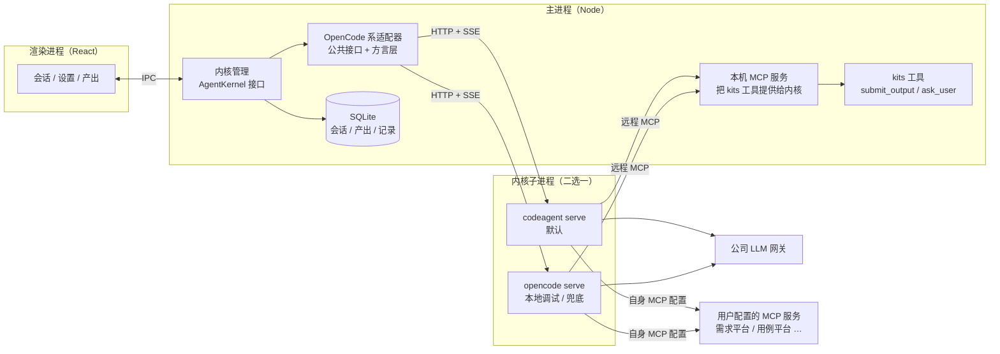

# kits 第一阶段方案：先打通通用的 Agent 流程

> 版本：v0.4（草案）　日期：2026-11-03　状态：待评审
>
> 本文记录第一阶段范围收窄后的方案。[design.md](https://github.com/cymoo/kaise/blob/main/docs/design.md) 和 [mvp-plan.md](https://github.com/cymoo/kaise/blob/main/docs/mvp-plan.md) 描述的是“服务端 + 网页”的完整平台，第一阶段不按那两份执行，其中的思路（内核适配层、结构化产出走工具、从第一天记录数据）在本文中沿用。
>
> v0.2 的变化：定位从“通用 Agent 工作台”改为“测试专用 Agent”；内核改为 CodeAgent 和 OpenCode 共用一个适配器，第一阶段不做 AI SDK 内核；统计上报第一阶段不做，但先列出可上报的内容（第 7 节）。
>
> v0.3 的变化：用例的样子还没定，第一阶段先做通用的 Agent 应用、打通通用流程；测试相关的功能（内置的用例设计 Agent、用例格式、用例审核等）放到第二阶段，界面上也不再放占位页。
>
> v0.4 的变化（2026-11-03 原型评审）：按轮回滚暂缓，第一阶段只看 diff，改动留在工作目录里由用户用 Git 处理或让 Agent 改回来；模型网关可以配多个，首次引导只配一个。
>
> 界面原型：[designs/app](../../designs/app/index.html)，2026-11-03 评审后的版本。

## 1. 结论

- **第一阶段做一个本地运行的 Electron 桌面应用，先打通通用的 Agent 流程**：配置模型和 MCP → 新建会话 → Agent 读文件、改文件、执行命令、调用 MCP → 确认和提问 → 查看改动和产出 → 导出。用例的样子还没定，测试相关的功能放到第二阶段。
- **最终做面向测试的 Agent，不做全功能的 coding agent 产品**：第二阶段起，内置 Agent、技能和界面逐步围绕测试来做；Agent 通用的功能都要有（对话、技能、MCP、读文件和搜索、向用户提问、自定义 Agent）；**编辑文件、执行命令等编码能力默认开启**，靠权限确认和工作目录限制控制风险（4.5 节）；结构化输出是可选项，不是必需的。
- **第一阶段只做通用功能**：会话、MCP、技能、Agent 配置、内核和模型设置、改动查看（回滚暂缓）、结果导出。用例设计、审核、测试编写、执行、分析都放到后面（原型里已经画出这几个页面，用于讨论第二阶段的设计）。
- **不需要服务端**。以后会有一个只展示统计信息的服务端，计划用 [lovia](https://github.com/cymoo/lovia) 搭建，第一阶段不做，只先定好上报哪些内容（第 7 节）。
- **不做 `pytest-kits` 插件**。用户可能有自己的测试执行器，以后做执行时再定关联方式。
- **Agent 内核**：默认 CodeAgent，OpenCode 用于本地调试和兜底，两者共用一个适配器，只用它们共有的接口（4.3 节）。第一阶段不做 AI SDK 内核，`AgentKernel` 接口保留。
- **结构化输出可选**：默认产出就是 Agent 的回复文本（Markdown）。Agent 设置了“输出格式”（JSON Schema）时才按格式提交结构化结果。第一阶段不内置任何业务格式。

## 2. 为什么现在可以做成本地应用

之前反对本地版的理由是团队协作、测试执行环境不一致、Agent 执行命令的安全风险。第一阶段不协作，前两条不成立了。第三条仍然存在：编码能力默认开启后，Agent 会在用户自己的电脑上改文件、执行命令，这和本机使用 Claude Code、OpenCode 的风险相同，第一阶段靠权限确认、工作目录限制和回滚来控制（4.5 节、第 6 节），不做沙箱。

本地应用还有一个实际好处：用户配置的 MCP 很多是 stdio 类型，需要在本机启动进程，也要读本地文件，桌面应用正好合适。

## 3. 功能范围

### 3.1 第一阶段做的

| 功能 | 说明 |
|---|---|
| 新建会话 | 选 Agent，写任务描述；可选附加上下文：通过 MCP 获取（如需求平台）、粘贴文本、上传文件（Word / PDF / Markdown / 图片，先转成文本）；可以用 `/命令` 快速开始 |
| 会话 | 对话加 Agent 的工作过程（技能加载、MCP 调用、读文件、改文件、执行命令，默认折叠）；文件改动可以查看 diff（按轮回滚暂缓，用户用 Git 提交或丢弃，或让 Agent 改回来）；Agent 提问卡片（不阻塞时先按假设继续，并在结果里注明）；工具调用确认卡片；停止；切换内核和模型 |
| 产出 | 默认是 Agent 的回复文本，可以编辑后导出为 Markdown；Agent 设置了输出格式时，是通过 `submit_output` 提交的结构化结果，可以逐条展开查看，导出为 Excel / Markdown / JSON |
| 上下文面板 | 本次会话用到的 Agent、内核、技能、MCP、附件、token 用量 |
| 设置 · 内核与模型 | 选择 CodeAgent 或 OpenCode；配置模型网关（OpenAI 兼容接口，可以配多个，首次引导只配一个），API Key 存系统钥匙串；模型按网关分组，选一个默认模型，各 Agent 可以单独指定 |
| 设置 · Agent | 提示词、模型、内置工具、技能、MCP、可选的输出格式；存成 Markdown 文件，可以用 Git 管理 |
| 设置 · MCP 服务 | 支持 stdio 和 Streamable HTTP；兼容常见的 `mcpServers` 配置，可直接粘贴；测试连接；每个工具设置“允许 / 询问 / 拒绝” |
| 设置 · 技能 | 遵循 Agent Skills 规范（`SKILL.md`），可复用 Claude、OpenCode、pi 的技能目录；按内置 / 项目 / 个人三级来源加载；可开关 |
| 设置 · 数据与隐私 | 数据只存本机；记录 AI 原稿与人工修改、token 用量；导出评测数据（JSONL） |
| 通用操作 | 会话历史、⌘K 搜索、⌘N 新建 |

### 3.2 第一阶段不做的（测试相关，放到后面）

| 模块 | 开始前要先定的事 |
|---|---|
| 用例设计 | 用例的样子（字段、粒度）；内置 `test-designer` Agent、默认用例格式、用例设计相关的技能；产出面板里的用例视图 |
| 用例审核 | 用例格式和审核流程 |
| 测试编写 | 编辑和执行工具第一阶段已经开启，用户可以在会话中让 Agent 写测试；专门的测试编写流程（按用例生成测试代码、关联用例编号）以后再做，届时评估是否需要沙箱 |
| 测试执行 | 用例编号和测试的关联方式；执行器由用户配置命令，报告统一按 JUnit XML 解析 |
| 结果分析 | 依赖执行结果的格式；缺陷平台的对接方式 |

团队协作、登录、GitLab 对接、统计服务也不在第一阶段。

## 4. 架构



### 4.1 内核接口

接口放在“会话”这一层：输入一份 Agent 配置和一句话，输出统一格式的事件流和结果。不抽象到“模型调用 + 工具执行”这一层，因为 CodeAgent 和 OpenCode 自己掌管 Agent 循环、内置工具和会话存储，在那一层统一不了。

```ts
// 会话整个传进来（id + 工作目录 + Agent + 模型），适配器不记会话，应用重启后从数据库读出来照样能续上
interface KernelSession { id: string; workdir: string; agent: string; model?: string }

interface AgentKernel {
  readonly id: 'codeagent' | 'opencode'           // 以后可能加 'ai-sdk' 等
  readonly capabilities: { subagents: boolean; revert: boolean }
  start(cfg: KernelConfig): Promise<void>        // 启动 serve 子进程，等待就绪
  createSession(opts: { workdir: string; agent: string; model?: string; title?: string; permission: PermissionSet }): Promise<KernelSession>
  prompt(session: KernelSession, input: UserInput): AsyncIterable<KernelEvent>   // 以一条 done 结束
  respondPermission(session: KernelSession, requestId: string, reply: 'once' | 'always' | 'reject', message?: string): Promise<void>
  abort(session: KernelSession): Promise<void>
  diff(session: KernelSession): Promise<FileDiff[]>   // 本次会话改了哪些文件（unified diff）
  summarize(session: KernelSession): Promise<void>    // 上下文压缩
  messages(session: KernelSession): Promise<KernelMessage[]>   // 断线补齐、恢复会话
  revert(session: KernelSession, messageId: string): Promise<void>
  dispose(): Promise<void>
}

type KernelEvent =
  | { type: 'text-delta'; partId: string; text: string }
  | { type: 'reasoning-delta'; partId: string; text: string }
  | { type: 'tool-start'; callId: string; name: string; input: unknown }
  | { type: 'tool-end'; callId: string; output: unknown; error?: string; title?: string }
  | { type: 'permission-request'; requestId: string; tool: string; input: unknown; patterns: string[]; always: string[]; callId?: string }
  | { type: 'usage'; inputTokens: number; outputTokens: number; cacheReadTokens: number; cacheWriteTokens: number; cost: number }
  | { type: 'retry'; attempt: number; message: string; nextAt: number }
  | { type: 'status'; state: 'busy' | 'idle' | 'retry' }
  | { type: 'compaction'; summary: string }
  | { type: 'done'; reason: 'completed' | 'aborted' | 'max-steps' | 'error'; error?: string }
```

回滚、子 Agent、上下文压缩等能力不进接口，用 `capabilities` 标出，界面按能力显示。会话和内核绑定，不支持中途换内核继续同一个会话。

### 4.2 所有配置只写一份，按内核转换

| 资产 | kits 的格式 | 转换到 CodeAgent / OpenCode |
|---|---|---|
| Agent 配置 | `agents/*.md`：提示词、模型、可用工具 | 生成内核配置里的 `agent` 字段，写入 kits 为内核准备的配置目录（4.3 节） |
| 技能 | 标准 `SKILL.md` | 内核原生支持；复制或链接到配置目录下内核约定的技能目录 |
| 用户配置的 MCP | 一份 `mcp.json` | 转成内核配置里的 `mcp` 字段 |
| kits 工具 | 用 zod 定义一次 | 主进程在本机起一个 MCP 服务提供 |
| 权限（允许 / 询问 / 拒绝） | 每个工具一条规则 | 转成内核配置里的 `permission` 规则；询问通过 `permission.asked` 事件推给界面 |
| 会话记录 | 统一格式，存 SQLite | 映射内核的 SSE 事件 |

### 4.3 CodeAgent 和 OpenCode 共用一个适配器

CodeAgent 基于 OpenCode，会话、消息、Part、工具状态的数据结构一致，大部分会话接口也相同（详见 [CodeAgent 与 OpenCode 的 API 对比](https://github.com/cymoo/kaise/blob/main/docs/codeagent-vs-opencode-api.md)）。所以只写一个适配器，**只调用两者共有的接口**，差异收在一个很薄的“方言层”里：

```ts
interface KernelDialect {
  spawn(cfg: KernelConfig): Promise<{ baseUrl: string; headers: Record<string, string>; close(): Promise<void> }>
  writeConfig(dir: string, cfg: GeneratedConfig): Promise<void>
  permissionReplyPath(requestId: string, sessionId: string): string
}
```

| 差异 | CodeAgent | OpenCode |
|---|---|---|
| 启动和就绪 | 端口 0，读 stdout 的 ready JSON | 指定空闲端口，轮询 `/global/health` |
| 路径前缀 | `/api/v1` | 无 |
| 鉴权 | Bearer token | Basic Auth |
| 配置注入 | `--config-dir` 指向 kits 生成的目录 | 环境变量指向 kits 生成的目录或文件 |
| 权限回复 | `POST /permission/:id/reply` | 按锁定版本选新接口或旧接口【待实测】 |

第一阶段用到的公共接口：健康检查、会话的创建 / 获取 / 删除 / 状态、`prompt_async`、`abort`、消息列表、`diff`、权限回复、`GET /event` 事件流，以及 Agent、命令、MCP、模型的列表接口。编码能力默认开启后，执行命令要频繁确认，权限回复是会话中的常用操作。完成判定用 `session.idle` 加 `GET /session/status` 轮询兜底，两边都支持。CodeAgent 独有的能力（`prompt.completed` 事件、工作区、`permission_mode`、问答接口）第一阶段不用。`revert` / `unrevert` 第一阶段不接：回滚暂缓，`AgentKernel` 接口保留 `revert` 和 `capabilities.revert`，以后需要时再接。注意 CodeAgent 的 spec 里没有 `unrevert`，到时要先确认。

OpenCode 在这里有两个用处：

- **本地调试**：开源，可以看源码、加日志、断点，问题能分清是 kits 的还是内核的；CI 里用 OpenCode 加一个 mock 模型跑契约测试，不依赖闭源二进制。
- **兜底**：CodeAgent 的离线运行、登录或分发出问题时，换成 OpenCode 不用改上层代码。

### 4.4 为什么第一阶段不做 AI SDK 内核

v0.1 计划同时实现 AI SDK 作为第二个内核，现在改为不做：

1. **本地调试由 OpenCode 承担**：它和 CodeAgent 是同一套接口，在 OpenCode 上调通的流程换到 CodeAgent 只差方言层。AI SDK 内核的行为和 CodeAgent 差得更远，用它调试反而定位不到 CodeAgent 上的问题。
2. **成本不小**：编码能力默认开启后，AI SDK 内核要自己补 MCP 客户端、技能加载、文件读写和命令执行工具、改动快照和回滚、会话存储，工作量会明显超过 v0.1 估计的 0.5~1 周，之后还要长期维护两套不同的 Agent 行为。
3. v0.1 的另一个理由是“第二个实现能防止接口被 OpenCode 的概念带偏”，这一点仍然成立。所以保留 `AgentKernel` 接口，不把 OpenCode 的概念泄漏到上层，以后需要时再加。

以后出现下面任一情况时再做：CodeAgent 和 OpenCode 都过不了 PoC（离线、私有化模型）；要按“内核 × 模型”做评测对比；需要完全掌控 Agent 循环。到时候除了 AI SDK，也可以评估 lovia（Python 写的轻量 Agent 框架，需要以子进程方式接入）。

### 4.5 默认工具集和权限

内核的通用能力和编码能力默认都开启，用权限规则控制风险。每个 Agent 可以在设置里单独关闭某个工具或调整权限。

| 类别 | 工具 | 默认权限 |
|---|---|---|
| 读取和搜索 | `read`、`grep`、`glob` | allow；`.env` 等敏感文件 ask（沿用内核默认） |
| 编辑 | `edit`（含 write / patch） | allow，限定在会话工作目录内；每次改动都有快照，可以在界面上查看 diff；回滚暂缓 |
| 执行命令 | `bash` | ask，弹出确认卡片，可选“本次会话内始终允许”；常见的只读命令（`ls`、`cat`、`git status / diff / log` 等）allow |
| 工作目录以外 | `external_directory` | ask |
| 其他通用能力 | `skill`、`todowrite`、`task`（子 Agent） | allow |
| LSP | `lsp` | allow；只用本机已安装的语言服务，关闭自动下载 |
| 联网 | `webfetch`、`websearch` | deny；只用内网模型，防止代码和需求外泄；需要时可在 Agent 上单独打开 |
| 死循环检测 | `doom_loop` | ask |
| 内核的提问工具 | `question` | deny，改用 kits 的 `ask_user` |
| kits 工具（本机 MCP） | `submit_output`：提交结构化结果，按 Agent 的 JSON Schema 校验，不合格把错误返回给模型让它改。只有 Agent 设置了输出格式时才提供这个工具 | allow |
| | `ask_user`：向用户提问，可标记是否阻塞；不阻塞时 Agent 按假设继续 | allow |
| 用户配置的 MCP | 读取类工具 | allow |
| | 写入类工具（比如往外部平台写数据） | ask，执行前弹出确认卡片 |

提问用 kits 自己的 `ask_user`，不用内核的 `question` 工具：OpenCode 的官方文档没有列出问答接口，自己的工具在两个内核上行为一致。

### 4.6 结构化输出是可选的

结构化输出不是必需的，用例格式也还没定，所以不在代码里写死字段：

- 输出格式是 Agent 上的一个可选项，用 JSON Schema 描述。不设置时，产出就是 Agent 的回复文本，按 Markdown 保存和导出；设置了才提供 `submit_output` 工具，并按格式校验。
- 设置输出格式的好处：可以导出 Excel、导入其他平台，也能按条统计采纳情况（7.2 节的 C3、C4）。不设置时，这些只能退化为整段文本的对比。
- 第一阶段不内置任何输出格式。第二阶段做用例设计时，再为 `test-designer` 定默认的用例格式，字段最好参考公司用例管理平台的导入格式。

这样格式定下来之前不用停工，定下来之后只改配置。

## 5. 内置 Agent

| Agent | 用途 | 工具 | 输出格式 |
|---|---|---|---|
| `assistant` | 不限定任务的通用 Agent | 4.5 节的工具集；全部已启用的技能和 MCP | 不设置 |

第一阶段只内置 `assistant`，用户可以自己新建 Agent。`test-designer` 等测试相关的 Agent 第二阶段再加。

## 6. 安全

- 编码能力默认开启（4.5 节）：编辑限定在会话工作目录内，有快照可以看 diff（回滚暂缓，用 Git 处理）；执行命令默认要确认；访问工作目录以外的路径要确认。
- 第一阶段不做沙箱，Agent 以当前用户的身份运行，风险和本机使用 Claude Code、OpenCode 相同。新建会话时要求选择工作目录，不默认使用用户主目录。
- 用户配置的 MCP 可能有副作用（比如往外部平台写数据），写入类工具默认是“询问”，执行前弹出确认卡片。
- 模型网关的 API Key 和 MCP 凭据存系统钥匙串，不写进配置文件。
- 内核只监听本机地址；关闭自动更新、分享、模型目录拉取、LSP 自动下载等联网功能；CodeAgent 还要关闭 AI Market 和账户相关的联网功能（能否关闭待 PoC 确认）。版本锁定后随应用打包。

## 7. 数据记录与统计上报

### 7.1 本机记录（第一阶段做）

从第一天起在本机记录：AI 原稿和人工修改后的对比、token 用量（按会话、Agent、模型）、采纳情况。可以导出为 JSONL 作为评测集样本。历史数据补不回来，所以本机记录的字段要覆盖 7.2 中以后可能上报的内容。

### 7.2 统计上报（第一阶段不做，先定内容）

以后会有一个只展示统计信息的服务端（计划用 lovia）。lovia 是 Python 写的 Agent 框架，自带基于 FastAPI 的网页对话界面，可以在对话中画表格和图表；接收上报的接口和固定的统计页面要自己在 FastAPI 上加路由，它本身不提供。第一阶段不上报，但要先选定上报哪些内容，本机记录按这个范围来设计。下表是候选项，“敏感度”指是否包含需求、代码、用例等业务内容；“建议”是起步时推荐的一组，供选择时参考。

**A. 使用情况**（不含业务内容）

| 编号 | 内容 | 用途 | 建议 |
|---|---|---|---|
| A1 | 应用版本、操作系统、内核类型和版本 | 版本分布，决定何时停止支持旧版本 | ✓ |
| A2 | 用户标识（工号，或匿名 ID）、部门 / 项目组 | 按人、按团队统计使用情况 | ✓（标识方式待定） |
| A3 | 活跃天数、启动次数、使用时长 | 推广效果 | ✓ |
| A4 | 各功能的使用次数：新建会话、`/命令`、导出（按格式）、设置项修改 | 哪些功能有人用 | ✓ |

**B. 会话指标**（不含业务内容）

| 编号 | 内容 | 用途 | 建议 |
|---|---|---|---|
| B1 | 会话数、每个会话的轮数和时长，按 Agent、模型、内核分组 | 使用强度 | ✓ |
| B2 | token 用量（输入、输出、推理、缓存命中）和折算成本 | 成本核算、模型选型 | ✓ |
| B3 | 工具调用次数和失败率，按工具名统计（含 MCP 服务名和工具名） | 哪些 MCP 和技能有用、哪些常出错 | ✓ |
| B4 | 技能加载次数，按技能名统计 | 技能的使用情况 | ✓ |
| B5 | 会话结束原因：完成、用户中止、步数上限、出错（错误类型） | 稳定性 | ✓ |
| B6 | 性能：首个 token 的延迟、总耗时、模型网关的错误和重试次数 | 定位模型网关问题 | ✓ |
| B7 | 权限确认的次数和结果（允许 / 拒绝），按工具统计 | 调整默认权限 | |
| B8 | `ask_user` 提问次数、是否阻塞、用户是否回答 | 评估 Agent 是否问得太多或太少 | |

**C. 产出质量**（不含业务内容，只有数量和比例；C1~C4 按条统计，只有使用结构化输出的会话才有，纯文本产出只能统计整段的修改比例；和用例相关的几项要到第二阶段才有数据）

| 编号 | 内容 | 用途 | 建议 |
|---|---|---|---|
| C1 | 每个会话生成的用例数量 | 产出量 | ✓ |
| C2 | `submit_output` 的 JSON Schema 校验失败次数和重试次数 | 模型对输出格式的遵循程度 | ✓ |
| C3 | 采纳情况：每条用例是原样保留、修改后保留还是删除，以及人工新增的条数 | 衡量 AI 质量的核心指标 | ✓ |
| C4 | 修改幅度：按字段统计的编辑距离或改动比例（只有数字） | 知道 AI 哪部分写得差（步骤、预期结果……） | ✓ |
| C5 | 从生成到导出的耗时 | 节省了多少时间 | |
| C6 | 用户评价：点赞 / 点踩，以及原因标签（漏测、步骤不清、与需求不符……） | 主观质量 | ✓ |
| C7 | 用户填写的文字反馈 | 具体问题 | |

**D. 配置**（可能含少量业务信息）

| 编号 | 内容 | 用途 | 建议 |
|---|---|---|---|
| D1 | 启用的 Agent、技能、MCP 服务的名称和版本（或内容哈希） | 对比不同配置的效果 | |
| D2 | 自定义 Agent 的提示词和输出格式（全文） | 收集好的写法，推广到团队 | |
| D3 | MCP 服务的地址（不含凭据） | 了解接入了哪些平台 | |

**E. 业务内容**（敏感，需要单独评估是否允许）

| 编号 | 内容 | 用途 | 建议 |
|---|---|---|---|
| E1 | 需求的标识（需求平台中的 ID、标题） | 按需求追溯用例，统计需求覆盖 | |
| E2 | 用户的任务描述和附件内容 | 了解大家怎么用、复现问题 | |
| E3 | AI 生成的用例原稿和人工修改后的最终版本 | 集中评测、积累评测集、调优提示词 | |
| E4 | 完整的会话记录（含工具调用的输入和输出） | 排查具体问题 | |

**F. 诊断**

| 编号 | 内容 | 用途 | 建议 |
|---|---|---|---|
| F1 | 应用崩溃和未处理异常的堆栈（脱敏路径） | 修 bug | ✓ |
| F2 | 内核进程的错误日志片段（启动失败、意外退出） | 修 bug | ✓ |

还要一起决定的几件事：

1. **用户标识**：工号（能按人统计，但涉及个人数据）还是匿名 ID（只能按设备统计）。
2. **用户能否关闭上报**：默认开启还是默认关闭；E 类即使选中，也建议每次单独征得同意，或只在用户主动“提交反馈”时上传。
3. **上报方式**：本机先写入队列，定时批量上传，断网时保留；服务端只接收，不回推任何配置。

## 8. 界面

原型在 [designs/app](../../designs/app/index.html)，本地起一个静态服务（`python3 -m http.server 8765 --directory designs/app`）打开 `index.html` 即可，页面之间可以点击跳转，主要控件可以交互。

| 页面 | 文件 | 内容 |
|---|---|---|
| 首次引导 | `onboarding.html` | 三步：模型网关（先配一个）、工作目录、MCP（可跳过） |
| 首页 | `index.html` | 输入框和几条示例任务；输入框上选工作目录、Agent、权限、模型，“+”里上传文件、引用、开关平台；输入 `/` 列出命令（技能），`@` 列出可引用的文件和需求 |
| 会话 | `session.html` | 对话流 + 右侧工作区面板（改动 / 产出 / 终端 / 上下文）。`?s=` 切换演示状态：`streaming` 运行中、`permission` 命令确认、`question` Agent 提问、`done` 完成、`error` 重试与出错、`context` 上下文接近上限、`changes` 改动面板放大、`output` 结构化产出放大 |
| 会话历史 | `history.html` | 全部会话，按状态筛选；⌘K 面板在任何页面都能打开，搜会话、跳转、切目录 |
| 设置 | `settings.html` | `#general` 通用（主题、字体、语言、通知、快捷键）、`#model` 内核与模型（网关可配多个）、`#mcp` MCP 服务（粘贴配置，每个工具三档权限）、`#skills` 技能与记忆、`#agent` Agent；权限和数据与隐私只有占位 |


侧栏、输入框和 ⌘K 面板由 `shell.js` 统一生成，各页面共用。侧栏只有新会话、搜索、按时间分组的会话列表（需要你处理或正在运行的会有一个小圆点和状态字）和底部的设置，可以用 ⌘B 折叠；个人信息放在设置页底部。

原型的改进建议见 [prototype-review.md](https://github.com/cymoo/kaise/blob/main/docs/prototype-review.md)。

界面参考了 Claude 桌面版和 Codex 这类桌面 Agent 应用（整体布局、工作过程折叠）、Claude Code 和 OpenCode 的权限机制（工具确认卡片、按工具设置权限）。

## 9. 分阶段路线

| 阶段 | 内容 | 到时候要做的决定 |
|---|---|---|
| **P1** | 本文描述的通用 Agent 桌面应用，打通通用流程 | — |
| P2 | 用例设计、用例审核；测试代码编写 | 用例格式和审核流程；内置的测试 Agent 和技能；专门的测试编写流程，届时评估是否需要沙箱 |
| P3 | 测试执行、结果分析 | 执行器由用户配置命令，报告统一按 JUnit XML 解析；用例编号约定写在测试名或 tag 里 |
| P4 | 统计服务；团队协作 | 统计服务用 lovia 搭建，按 7.2 节选定的内容接收上报；共享、审核等协作功能需要时再加 |

## 10. 工期粗估

按 2~3 人估算，未核实：

| 内容 | 时间 |
|---|---|
| PoC：模型经公司网关的工具调用稳定性；CodeAgent 离线运行、免登录；导出 CodeAgent 的 OpenAPI 核对公共接口 | 1 周 |
| 共享层：工具定义、本机 MCP 服务、配置转换、事件模型 | 约 1 周 |
| OpenCode 系适配器：公共接口、CodeAgent 和 OpenCode 两个方言、打包二进制、进程管理、关闭联网、SSE 映射、判断会话完成；OpenCode + mock 模型的契约测试 | 约 1.5 周 |
| 界面：会话、设置、产出导出 | 约 1.5 周 |
| 打包、签名、内网自动更新 | 约 0.5 周 |
| 评测集和提示词调优 | 和上面同时进行 |

## 11. 待确认

1. **模型**：候选型号经公司网关的工具调用是否稳定（PoC 第一项，不过的话方案要调整）。
2. **用例格式**：向用例管理平台要一份导入模板或 API 字段说明。
3. **CodeAgent**：能否不登录、完全离线运行；能否关闭 AI Market 和账户相关的联网功能；能否随 kits 安装包一起分发（许可）；配置目录里 OpenCode 风格和 Claude Code 风格的配置以哪个为准。详见 [API 对比](https://github.com/cymoo/kaise/blob/main/docs/codeagent-vs-opencode-api.md) 第 7 节。
4. **OpenCode 分发**：作为调试和兜底内核，二进制能否随应用打包，是否通过公司安全扫描（含 Bun 运行时）。
5. **桌面应用分发**：macOS 公证和 Windows 签名用哪个证书；内网自动更新放在哪里。
6. **MCP 服务**：需求平台、用例平台是否已有 MCP 服务，没有的话由谁来写。
7. **统计上报**：从 7.2 节选定上报内容，以及用户标识方式和能否关闭上报。
